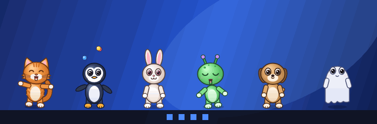
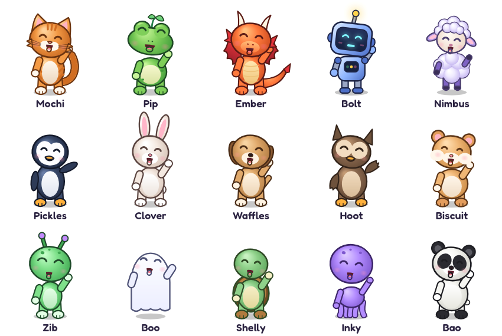
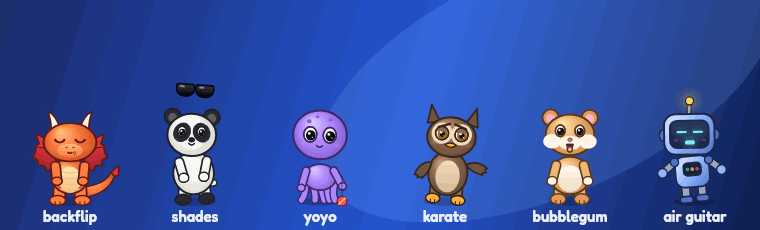
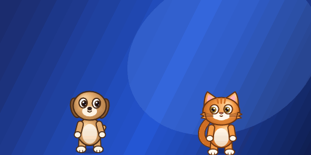

<h1 align="center">PixelBuddy 🐾</h1>

<p align="center"><b>Your desktop deserves a little chaos.</b><br>15 adorable desktop companions. Free forever.</p>

<p align="center"></p>

<p align="center">
  <a href="https://github.com/vallentes/pixelbuddy/releases/latest"><b>⬇ Download for Windows / macOS</b></a>
  &nbsp;·&nbsp; <a href="#installation">Installation</a>
  &nbsp;·&nbsp; <a href="https://vallentes.github.io/pixelbuddy/">Website</a>
</p>

## Download

| Windows 10 / 11 | macOS 11+ (Apple Silicon and Intel) |
| --- | --- |
| [`PixelBuddy_x.y.z_x64-setup.exe`](https://github.com/vallentes/pixelbuddy/releases/latest) | [`PixelBuddy_x.y.z_universal.dmg`](https://github.com/vallentes/pixelbuddy/releases/latest) |

Free, no ads, no accounts, no tracking ([privacy policy](PRIVACY.md)). It updates itself when a new version is out.

## Meet all 15 pets

<p align="center"></p>

A cat, frog, dragon, robot, cloud-sheep, penguin, bunny, puppy, owl, hamster, alien, ghost, turtle, octopus and panda. Each comes in 6 colors with hats, bows, scarves and more, drawn in smooth HD or crisp pixel art.

## Features and interactions

<p align="center"> </p>

* **They talk.** Natural voices that run offline on your computer, or cute babble. Jokes with real comic timing, fun facts and gentle roasts.
* **19 tricks.** Backflips, moonwalks, juggling, magic, karate, air guitar, bubblegum, selfies and "deal with it" shades.
* **Poke them.** Boop the nose, tickle the belly, pull the tail, press and hold for a hug, or throw them across the screen.
* **They have friends.** Adopt several and they chat, play tag, prank each other and hold joke-offs.
* **Record a clip.** Right-click a pet, *Record a clip*, portrait or landscape. It films a short show and saves the video to your Videos folder. Only the pet is filmed, never your screen.
* **Buddy codes.** Share a pet as a short code. A friend pastes it and your pet visits their desktop.
* **Naughty mode** (optional). They steal a pretend cursor, throw tantrums when ignored and get jealous. Your real mouse is never touched.
* **They notice what you're doing** (optional, off by default). They sit and watch videos with you, dance to Spotify and name the song, go silent in Zoom/Teams/Meet calls, offer to bite your emails, cheer when you type fast and tell you to go to bed at 2 a.m. Only the app name and window title are checked, on your computer, and then forgotten. See [PRIVACY.md](PRIVACY.md).
* **Climb on windows** (Windows, optional). Pets jump onto the window you're using and ride along when you drag it.
* **Focus timer.** Right-click a pet or use the tray: pets go quiet for 25 or 50 minutes and cheer when you're done.
* **Break and water reminders** (optional). A pet stretches after an hour at the computer and reminds you to drink water.
* **Polite.** Hides during fullscreen games and videos, naps when you're away, has a low-power mode.

## For streamers

* Transparent **OBS overlay**: Settings, Streaming shows the URL (default `http://127.0.0.1:47823/overlay`). Add it as a Browser Source, for example 1920x300. Works without Twitch.
* **Twitch reactions**: follows, cheers, raids and channel point rewards make pets react. A new sub makes them **evolve** (golden, crowned and sparkly for a minute) and gift subs bring **confetti**.

## Installation

### Windows 10 / 11

1. Download **`PixelBuddy_x.y.z_x64-setup.exe`** from [Releases](https://github.com/vallentes/pixelbuddy/releases/latest).
2. Run it. Windows may show **"Windows protected your PC"** because the installer is not code-signed yet: click **More info → Run anyway**.
3. It installs for your user only (no admin needed) and starts PixelBuddy. Pick your first pet and give it a name.
4. PixelBuddy lives in the **system tray** (bottom right, near the clock; click the `^` arrow if you don't see it). Click the icon to open Settings, right-click it for quick actions.

Uninstall from **Settings → Apps → Installed apps → PixelBuddy**. Your pets are kept in `%APPDATA%\app.pixelbuddy.desktop` if you reinstall later. The **`.msi`** is the same app for managed installs (`msiexec /i PixelBuddy_x.y.z_x64_en-US.msi /qn`).

### macOS 11 or newer

1. Download **`PixelBuddy_x.y.z_universal.dmg`** from [Releases](https://github.com/vallentes/pixelbuddy/releases/latest).
2. Open the `.dmg` and drag **PixelBuddy** into **Applications**.
3. The app is not notarized by Apple yet, so the first launch needs one extra step: open **Applications**, **right-click PixelBuddy → Open**, then click **Open** again. (On macOS 15+: try to open it once, then go to **System Settings → Privacy & Security** and click **Open Anyway**.)
4. PixelBuddy appears in the **menu bar** at the top right. Allow notifications if you want hunger reminders.

Uninstall by dragging PixelBuddy from Applications to the Trash.

### First steps

* **Talk:** Settings → Personality → Voice → *Natural voices* (one-time download, runs offline after that). Add your name so your pets greet you.
* **Play:** right-click a pet for food, games and **Tricks**.
* **Friends:** adopt a second pet (Settings → Pets) and watch what happens.

## Roadmap

- [x] 15 pets, talking, tricks, pet-to-pet play
- [x] Automatic updates
- [x] Record clips, buddy codes, naughty mode, Twitch evolve
- [x] Desktop awareness, focus timer, climbing on windows
- [ ] Signed Windows installer and notarized Mac app (no more security prompts)
- [ ] Create your own buddy
- [ ] More pets and seasonal outfits
- [ ] Linux build

## Support development ☕

PixelBuddy is free and always will be. If it made you smile, a tip keeps it going:

<table>
<tr>
<td align="center" width="50%">

**[☕ Buy Me a Coffee](https://buymeacoffee.com/vallentes)**

</td>
<td align="center" width="50%">

**[Revolut · @vallentes](https://revolut.me/vallentes)**

<a href="https://revolut.me/vallentes"></a>

Card, Apple Pay or Revolut. No account needed.

</td>
</tr>
</table>

A ⭐ on this repo helps a lot too.

## Technical documentation

### Stack

* Tauri 2 + Rust core, React + TypeScript settings UI, canvas renderers (HD vector rig and pixel art)
* SQLite (bundled) for pets and settings; OS keychain for Twitch tokens
* Natural voices: Kokoro-82M (Apache-2.0), run locally with ONNX Runtime (WebGPU, or multi-threaded CPU as fallback)
* Font: Fredoka (SIL Open Font License), bundled

See [ARCHITECTURE.md](ARCHITECTURE.md) and [SECURITY_PERFORMANCE_REVIEW.md](SECURITY_PERFORMANCE_REVIEW.md).

### Layout

| Path | What |
| --- | --- |
| `src-tauri/` | Rust core: pets, settings, windows, tray, overlay server, Twitch, voice model download |
| `src/settings/` | React settings app, plus the natural-voice service (runs in the main window) |
| `src/pet/` | Pet window: rendering, movement, touch, drag/throw, talking, pet-to-pet social layer |
| `src/hd/` | HD vector characters: pose rig, drawing, props, particles |
| `src/sprites/` | Pixel-art characters (procedural, original) |
| `src/engine/` | Behavior brain, chatter and jokes, social scripts, motion (pure, unit tested) |
| `src/overlay/` | OBS overlay page served by the app on 127.0.0.1 |

### Develop

Requirements: Node 20+, Rust stable, and on Windows the Visual Studio 2022 Build Tools with "Desktop development with C++" (WebView2 ships with Windows 11). On macOS: Xcode command line tools.

```bash
npm install
```

```bash
npm run tauri dev
```

```bash
npm test
```

```bash
cargo test --workspace
```

A bare `cargo build` produces a dev-mode binary that loads `http://localhost:1420`; use `npm run tauri build`, or add `--features tauri/custom-protocol` for a debug binary with the bundled pages.

The dev-only art gallery (`gallery.html`, all characters and tricks, plus a voice test) runs with `npm run dev`; open `http://localhost:1420/gallery.html`.

### Twitch setup

Create a **Public** application at https://dev.twitch.tv/console/apps, then either build with `PIXELBUDDY_TWITCH_CLIENT_ID=...` or paste the Client ID in Settings, Streaming. Login uses Twitch's device-code flow; no secret is shipped.

### Release

* **Windows:** `npm run tauri build` makes `target/release/bundle/nsis/PixelBuddy_<v>_x64-setup.exe` (per-user) and `msi/PixelBuddy_<v>_x64_en-US.msi`. Sign by setting `bundle.windows.certificateThumbprint` to your code-signing certificate.
* **macOS:** on a Mac, `npm run tauri build -- --target universal-apple-darwin`, with `APPLE_SIGNING_IDENTITY`, `APPLE_ID`, `APPLE_PASSWORD`, `APPLE_TEAM_ID` set to sign and notarize.

Bump the version in `package.json`, `src-tauri/Cargo.toml` and `src-tauri/tauri.conf.json` first. `.github/workflows/release.yml` builds both platforms on a `v*` tag if the repo is hosted on GitHub.

### Data

* Windows: `%APPDATA%\app.pixelbuddy.desktop\` (database `pixelbuddy.db`, voice model in `voice-models\`), logs in `%LOCALAPPDATA%\app.pixelbuddy.desktop\logs`
* macOS: `~/Library/Application Support/app.pixelbuddy.desktop/`
* Keychain (service `app.pixelbuddy.desktop`): `twitch_tokens` only when Twitch is connected

## License

Copyright (c) 2026 Valentin Vina (Vallentes). All rights reserved. The official builds are free to download and use; see [LICENSE](LICENSE).
